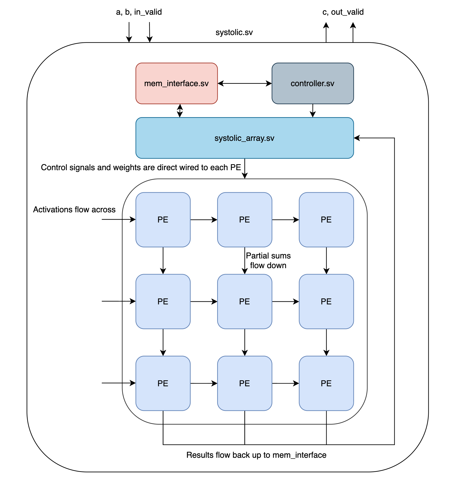
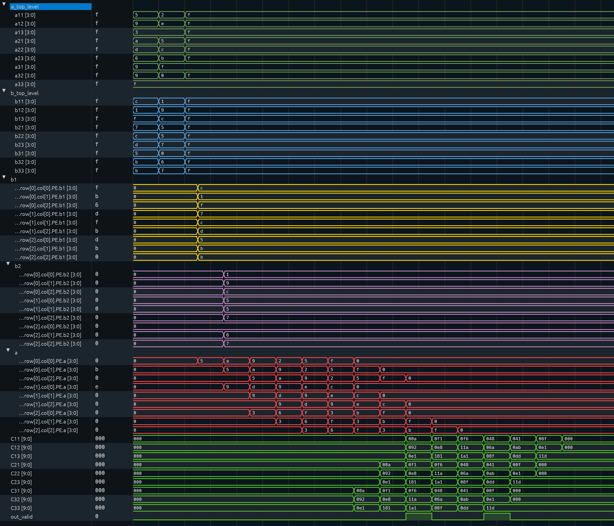

Overview:

This is a scalable 3x3 double buffered systolic array accelerator. Inputs are 4-bit unsigned, and the outputs are 10-bit unsigned. This unit accelerates matrix multiplications in hardware by holding weights in registers and allowing activations to flow over. This implementation utilizes 2 register slots holding weights which enables a preload structure, wherein a secondary set of weights may be loaded during the computation on the first set of weights. This advantage allows for matrix multiplications to be processed back to back with zero delay, by removing the need to wait for the first set to process and the number of cycles to load a second set of weights. 

Block Diagram:

How to run it:
1. Generate the tests
    `python3 gen_tests.py`
2. Compile using Verilator
    `verilator --binary --trace -j 0 *.sv --top-module systolic_tb`
3. Execute it
    `./obj_dir/Vsystolic_tb`
4. Use surfer to view the dump
    `surfer dump.vcd`

Tested using Verilator 5.052 and Surfer 0.7.0
Note: surfer_layouts/final_viewer.ron is a useful layout to follow the data, a, b1, and b2 waveforms are shown in row major format.

**File List:**
gen_tests.py – Generates job definitions, A and B matrixes and expected value C matrix.
systolic.sv – Instantiates all lower level modules, connects ports between modules.
systolic_tb.sv – Simulates tests. Drives A and B into the unit and compares to expected value. Reads from tests.txt generated by gen_tests.py.
controller.sv - FSM for controlling states within the systolic array.
controller_tb.sv - Testbench for controller.
mem_interface.sv – Regulates data going into systolic array, skews A matrices and direct loads B.
mem_interface_tb.sv – Testbench for mem_interface.
systolic_array.sv – Instantiates SIZE x SIZE (9) processing elements and connects wires so activations flow across and partial sums flow down.
SA_tb.sv - Testbench for systolic array.
processing_element.sv – Computes. Inputs weights into one of two slots, computes multiplication depending on signals. Adds to partial sum.
PE_tb.sv – Testbench for a singular processing element.

**Assumptions:**
This design assumes inputs will always be unsigned 4-bits, and outputs will always be unsigned 10-bits, and that data coming in will always exist. There is no infinity case, and no NaN case. It is assumed that the second group of matrices will arrive within 4 cycles of the first job, or there would be no way of checking back to back processing. It is also assumed that out_valid can be a one cycle pulse and C is valid on only that flagged cycle.

**Design choices:**
This design is a weight stationary architecture. This is defined as weights sitting in processing elements and activations flowing over them. The weights are loaded using direct load, rather than shifting down columns. The slot signals travel with data. So for loading weights, the weights and a bit indicating weight slot 1 or 2 travel into each PE. Similarly, the signal for which register to read from to compute A[i][j] x B[i][j] travels with matrix A pipelined across the array, since a global compute slot would force a 4 cycle gap between matrix multiplications. Mem_interface controls the skew and deskew of A and results, and takes in the whole matrix at once.

**Verification:**
Testbenches are provided for each module.
PE_tb covers basic multiplication accumulation behavior of a processing element.
SA_tb ensures data can be processed through the systolic array.
controller_tb checks that correct states are being achieved provided signals.
mem_interface_tb tests that data is being properly fed in and skewed correctly.
systolic_tb drives the overall unit and runs full matrix multiplication tests with verification.

**Waveform Screenshot**

